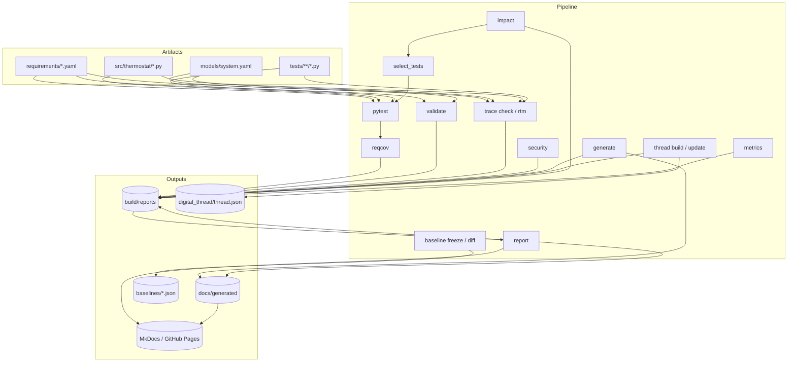

# Digital Thread Validator

A DevOps and DevSecOps pipeline for Model-Based Systems Engineering (MBSE),
applied to a small **Smart Thermostat Controller**. Requirements, the system
model, source code, and tests are plain, versioned files. Every change is
validated, traced, tested, scanned, analysed for impact, recorded in a digital
thread, and published as reports and a documentation site.

The project answers a practical systems-engineering problem: when a
requirement or model changes, which blocks, code, tests, reports, and releases
are affected? Instead of discovering this late in a document-driven process,
the pipeline answers it on every commit and pull request.

## What it demonstrates

- Requirements as code: one YAML file per requirement under `requirements/`.
- A YAML system model under `models/` validated by JSON Schema.
- Python source tagged with `@implements REQ-…` comments and pytest tests
  tagged with `@pytest.mark.req("REQ-…")`.
- Automatic traceability, RTM generation, impact analysis, selective testing,
  requirement coverage, and a versioned digital-thread graph.
- Security gates for secrets, SAST, dependency vulnerabilities, containers,
  and infrastructure as code.
- Release baselines, conventional-commit checks, deterministic changelogs,
  DORA metrics, a staging deployment with smoke tests, and rollback.
- A GitHub Actions CI/CD pipeline with pull-request impact comments and a
  MkDocs site published to GitHub Pages.

## Architecture



The **digital thread** is a deterministic NetworkX graph serialized to
`digital_thread/thread.json`. It connects requirements, model elements, source
modules, tests, test results, reports, commits, releases, and deployments.
Snapshots are kept under `digital_thread/history/`, and `thread update` writes a
human-readable diff with stale-node detection to
`build/reports/thread_diff.md`.

## Repository layout

| Path | Purpose |
|---|---|
| `requirements/` | One YAML requirement per file (`REQ-001.yaml` … `REQ-013.yaml`) |
| `models/system.yaml` | Blocks, interfaces, behaviors, and their trace links |
| `models/schema/` | JSON Schemas for requirements and the model |
| `src/thermostat/` | FastAPI Smart Thermostat implementation, tagged with requirement IDs |
| `tests/unit/`, `tests/integration/`, `tests/perf/`, `tests/requirements/` | pytest suites; requirement tests use `@pytest.mark.req(...)` |
| `pipeline/mbse/` | The `mbse` CLI and all pipeline modules |
| `pipeline/tests/` | Unit tests for the pipeline itself |
| `scripts/` | `demo.sh`, `smoke_test.py`, and `feedback.py` |
| `infra/` | Multi-stage Dockerfile, staging Compose file, Terraform bucket |
| `.github/workflows/` | CI, security, Pages, PR impact, thread, release, deploy, rollback |
| `docs/` | MkDocs sources, generated pages, and published reports |
| `baselines/` | Frozen release baselines (`baseline-<version>.json`) |
| `digital_thread/` | Current thread snapshot and per-commit history |
| `build/` | Generated reports, diagrams, stubs, OpenAPI, SBOM, coverage |
| `site/` | MkDocs build output (generated; not committed) |

## Setup

Requires Python 3.11 or newer and Git.

```bash
# from the repository root (clone or download it first)
cd digital-thread-validator
python -m venv .venv
source .venv/bin/activate
python -m pip install --upgrade pip
python -m pip install -e '.[dev]'
```

The editable install exposes the `mbse` command. The development extras include
pytest, coverage, MkDocs Material, bandit, pip-audit, CycloneDX, pre-commit,
yamllint, and ruff.

Optional external tools are detected at runtime:

- `gitleaks`, `semgrep`, `trivy`, and `checkov` are used when installed; when
  absent, `mbse security` records them as `unavailable` and CI runs the real
  checks.
- Secret scanning always has a Python fallback, so a committed key is caught
  locally.
- Graphviz `dot` is optional; diagram sources are always generated.
- `git-cliff` is optional; the deterministic Python changelog generator is the
  documented fallback.

## Quick start

```bash
mbse validate all       # validate requirements, model, and schemas
mbse trace check        # check requirement -> model -> code -> test links
pytest                  # run all tests and write JUnit, coverage, req results
mbse trace rtm          # write build/reports/rtm.{csv,md,html}
mbse reqcov             # gate approved-requirement coverage at 90%
mbse security           # run scanners and the security gate
mbse thread update      # update the digital thread and staleness report
mbse impact --base origin/main --head HEAD
mbse report             # aggregate summary and generated site pages
mkdocs build --strict   # build the documentation site
```

On a fresh checkout without `origin/main`, use `mbse impact --base HEAD~1
--head HEAD` or a tag such as `v1.0.0`.

## Command reference

### Validation and traceability

| Command | Effect |
|---|---|
| `mbse validate [schema\|reqs\|model\|all]` | Validate schemas, requirement quality rules (`RQ-001`…`RQ-008`), the model, and model references. Prints `path: rule severity: message`; errors exit non-zero. Default: `all`. |
| `mbse trace check` | Check traceability rules (`TRC-001`…`TRC-006`) and print traceability and verification coverage. Errors exit non-zero. |
| `mbse trace rtm` | Write the requirements traceability matrix to `build/reports/rtm.csv`, `rtm.md`, and `rtm.html`. |
| `mbse reqcov [--threshold FLOAT] [--results PATH]` | Compute approved-requirement coverage from `req_results.json`; writes `build/reports/reqcov.json`. Default threshold: 90%. Below it the command exits non-zero. |

### Tests, security, and impact

| Command | Effect |
|---|---|
| `pytest` | Run unit, integration, performance, requirement, and pipeline tests. Writes `build/reports/junit.xml`, `coverage.xml`, `pytest.html`, and `req_results.json`. |
| `python -m mbse.select_tests` | Print the space-separated pytest node IDs classified as `needs_retest` in `build/reports/impact.json`; prints nothing when there are none. |
| `mbse security` | Run gitleaks, bandit, semgrep, pip-audit, trivy, and checkov as available; write `build/reports/security.json` and `security.sarif`; exit non-zero when the gate fails. |
| `mbse impact [--base REF] [--head REF]` | Analyse changes between Git revisions, classify artifacts, write `impact.json`, `impact.md`, and `rtm_diff.md`, and print a summary. Defaults: `--base origin/main --head HEAD`. |
| `mbse report` | Recompute validation, traceability, and coverage, read available reports, write `build/reports/summary.json`/`summary.md` and `docs/generated/*.md`, and copy reports to `docs/reports/`. |

### Digital thread

| Command | Effect |
|---|---|
| `mbse thread build` | Build the graph, write `digital_thread/thread.json`, render GraphML/DOT/SVG, and write `docs/thread.md`/`thread.html`. |
| `mbse thread update` | Build the graph, diff it against the previous snapshot, mark stale `Test`, `CodeModule`, and `TestResult` nodes, write a history snapshot and `build/reports/thread_diff.md`. |
| `mbse thread query --upstream ID` | Show artifacts that `ID` depends on. |
| `mbse thread query --downstream ID` | Show artifacts that depend on `ID`. |
| `mbse thread query --why-failed ID` | Explain a failing test or result: outcome, verified requirements, and exercised code. |
| `mbse thread query --history ID` | Show `git log --follow` history for the node's file. |
| `--json` | Machine-readable output for any `thread query` mode. Exactly one query option is required. |

### Generation

| Command | Effect |
|---|---|
| `mbse generate [diagrams\|docs\|openapi\|test-stubs\|sbom\|all]` | Generate deterministic artifacts: PlantUML/Graphviz diagrams, Jinja2 documentation pages, OpenAPI, requirement test stubs, and a CycloneDX SBOM. Default: `all`. |
| `mbse metrics` | Write `build/reports/metrics.json` with DORA metrics (deployment frequency, lead-time median, change-failure rate, MTTR), pipeline tests/coverage, flaky count, and stage timings. |

### Baselines, changelog, and commits

| Command | Effect |
|---|---|
| `mbse baseline freeze VERSION` | Write `baselines/baseline-<VERSION>.json` containing SHA-256 hashes of every requirement, model, source, and test file plus the current RTM and thread snapshot. |
| `mbse baseline diff OLD NEW` | Compare two stored baselines; print artifact, RTM, and thread counts; write `build/reports/baseline_diff.json` and `.md`. A missing baseline exits non-zero. |
| `mbse changelog [--version VERSION] [--output PATH]` | Generate a deterministic Markdown changelog grouped by conventional-commit type and requirement IDs. Default output: `build/reports/changelog.md`. |
| `mbse commits check [--range RANGE] [--strict]` | Check conventional-commit subjects (`CC-001`) and requirement references for commits touching `requirements/`, `models/`, or `src/` (`CC-002`). Default range: `HEAD~1..HEAD`. Findings are warnings unless `--strict`, which makes them errors. |

### Make targets

| Target | Runs |
|---|---|
| `make validate` | `mbse validate all` |
| `make trace` | `mbse trace check` |
| `make test` | `python -m pytest` |
| `make test-selective` | pytest with the IDs from `python -m mbse.select_tests` |
| `make reqcov` | `mbse reqcov` |
| `make security` | `mbse security` |
| `make thread` | `mbse thread update` |
| `make impact` | `mbse impact --base $(BASE) --head $(HEAD)` (defaults `origin/main` and `HEAD`) |
| `make report` | `mbse report` |
| `make gen` | `mbse generate all` |
| `make site` | `make gen`, `make report`, then `mkdocs build --strict` |
| `make install` | `python -m pip install -e '.[dev]'` |
| `make clean` | Remove build, site, coverage, caches, and egg metadata |
| `make all` | `validate`, `trace`, `test`, `thread`, `impact`, `report` |

### Scripts

| Command | Purpose |
|---|---|
| `python scripts/smoke_test.py --base-url http://127.0.0.1:8000 --token TOKEN` | Black-box staging smoke checks: `GET /status`, unauthenticated update rejection, setpoint range, and REQ-013 p95 latency. Prints JSON and exits non-zero on failure. |
| `python scripts/feedback.py --observed-p95-ms 120 [--requirement REQ-013] [--apply]` | Compare an observed p95 against the requirement threshold, write `build/reports/feedback.json`, and optionally open/update a GitHub issue with `--apply`. Exits 1 when the threshold is violated. |
| `./scripts/demo.sh` | Run the complete demo in a temporary repository without GitHub access; see [docs/demo.md](docs/demo.md). |
| `pre-commit run --all-files` | Run the configured local hooks (ruff, yamllint, markdownlint when available, validation, tests as configured). |
| `mkdocs build --strict` | Build the documentation site and fail on broken links or missing navigation targets. |

## Pipeline stages

1. **Validate** — JSON Schema validation, requirement quality rules, model
   loading, and model reference checks. Errors gate the pipeline.
2. **Trace** — build links from requirements to satisfying model elements,
   implementing code tags, and verifying tests; report missing or unknown
   links. Generate the RTM.
3. **Test** — pytest writes JUnit, coverage, HTML, and the requirement-results
   map. The `req` marker ties each test to one or more requirement IDs.
4. **Requirement coverage** — an approved requirement counts as covered when at
   least one req-tagged test passes. The default gate is 90%.
5. **Security** — secret scanning, SAST, dependency audit, filesystem/container
   scan, and IaC scan. Gate policy is documented in
   [docs/devsecops.md](docs/devsecops.md).
6. **Digital thread** — build or update the graph, diff snapshots, flag stale
   downstream nodes, and record Git history for nodes.
7. **Impact** — map changed files onto graph nodes, traverse upstream and
   downstream, classify artifacts, compute risk, and write the report and RTM
   diff.
8. **Selective tests** — `needs_retest` test IDs feed `make test-selective`,
   shortening pull-request feedback while the full suite still runs in CI.
9. **Generate** — deterministic diagrams, docs, OpenAPI, test stubs, and SBOM.
10. **Report and site** — aggregate all reports into a pass/fail summary and
    generated site pages; MkDocs publishes the site.
11. **Metrics** — DORA and pipeline metrics are written to
    `build/reports/metrics.json` and rendered on the metrics page.
12. **Release** — on a `v*` tag, run the gates, freeze a baseline, generate the
    changelog, and attach the evidence to a GitHub Release.
13. **Deploy** — on `main`, build and scan the image, deploy the staging stack,
    run smoke tests including REQ-013 p95, record the deployment in the thread,
    and require approval for the production placeholder.

## Reports and documentation site

Machine-readable and human-readable reports are written under `build/reports/`:

| Report | Contents |
|---|---|
| `req_quality.json` | Requirement quality findings and per-requirement rule scores |
| `rtm.csv` / `.md` / `.html` | Requirement traceability matrix |
| `junit.xml` / `pytest.html` | Full test results |
| `coverage.xml` / `htmlcov/` | Line coverage |
| `req_results.json` | Requirement IDs mapped to test node IDs, outcomes, and durations |
| `reqcov.json` | Per-requirement coverage and the gate threshold |
| `security.json` / `security.sarif` | Scanner status, findings, and SARIF for code scanning |
| `sbom.json` | CycloneDX software bill of materials |
| `impact.json` / `impact.md` | Changed and affected artifacts, risk, reasons |
| `rtm_diff.md` | Requirement-level RTM diff against the base revision |
| `thread_diff.md` | Added, removed, modified, and stale thread nodes |
| `summary.json` / `summary.md` | Aggregated pipeline status |
| `baseline_diff.json` / `.md` | Artifact, RTM, and thread differences between baselines |
| `metrics.json` | DORA and pipeline metrics |
| `feedback.json` | Runtime feedback-loop result |
| `changelog.md` | Generated changelog |

`mbse report` writes `docs/generated/summary.md`, `tests.md`, `security.md`,
`impact.md`, and `metrics.md`, then copies every report to `docs/reports/`.
`mbse generate docs` writes the requirements, architecture, and RTM pages, and
`mbse thread build` writes the digital-thread page. The MkDocs navigation is in
`mkdocs.yml`; `make site` produces a strict, link-checked build under `site/`.
The Pages workflow uploads `build/reports/` as an artifact and deploys `site/`.

## Security

The security workflow and `mbse security` run the same policy:

| Tool | Scope | Gate |
|---|---|---|
| gitleaks | Secrets, with a Python fallback when the binary is absent | Any finding |
| bandit | Python security issues in `src/` and `pipeline/mbse/` | High severity |
| semgrep | Python static analysis | High severity |
| pip-audit | Known dependency vulnerabilities | Any vulnerability (treated as high) |
| trivy | Filesystem/container vulnerabilities | Critical |
| checkov | Terraform under `infra/` | Reported (soft-fail) |
| `SEC-001` / `TRC-006` | Approved security requirements without req-tagged tests | Error |

`.github/workflows/security.yml` runs secret scanning, SAST, dependency audit
plus SBOM, filesystem scanning, IaC scanning, and the aggregate `mbse security`
gate, uploading SARIF to GitHub code scanning. Reports are deterministic:
sorted findings, no timestamps. Local `unavailable` results mean "not verified
here", not "passed"; CI installs and runs the real tools.

## Baselines and releases

A baseline freezes the state of the engineering artifacts at a point in time:

```bash
mbse baseline freeze v1.0.0
# -> baselines/baseline-v1.0.0.json
```

Each baseline records the SHA-256 of every file under `requirements/`,
`models/`, `src/`, and `tests/`, the current RTM rows, and the digital-thread
snapshot. Comparing releases is local and deterministic:

```bash
mbse baseline diff v1.0.0 v1.1.0
# prints artifact/RTM/thread counts and paths
# -> build/reports/baseline_diff.json
# -> build/reports/baseline_diff.md
```

Tagging a `v*` commit (or running the release workflow manually with a version)
executes `.github/workflows/release.yml`: validation, traceability, tests,
security, thread update, baseline freeze, and changelog generation. The GitHub
Release receives:

- `baselines/baseline-<VERSION>.json`
- `CHANGELOG-<VERSION>.md`
- `build/reports/rtm.csv`
- `build/reports/sbom.json`
- `build/reports/summary.json`
- `digital_thread/thread.json`

The changelog groups conventional-commit types and lists requirement IDs found
in commit subjects and bodies. When `git-cliff` is unavailable, the Python
generator in `pipeline/mbse/changelog.py` is used; this fallback is recorded in
[docs/decisions.md](docs/decisions.md).

Conventional commits can be checked locally before pushing:

```bash
mbse commits check --range origin/main..HEAD --strict
```

`CC-001` reports non-conventional subjects. `CC-002` reports commits that touch
`requirements/`, `models/`, or `src/` without a `REQ-…` reference. Both are
warnings by default and errors with `--strict`.

## Deployment

`.github/workflows/deploy-staging.yml` deploys on pushes to `main` and on manual
dispatch. It:

1. builds the multi-stage, non-root image from `infra/Dockerfile` and pushes it
   to GHCR tagged with the commit SHA;
2. scans the image with Trivy and blocks critical findings;
3. brings up `infra/docker-compose.staging.yml` with `--no-build`;
4. waits for `GET /status`, then runs `scripts/smoke_test.py` against the
   deployed service;
5. collects container logs and uploads the staging deployment reports;
6. runs `mbse thread update` with `DEPLOY_ENVIRONMENT=staging` and
   `DEPLOY_IMAGE_TAG=<sha>`, which adds a `Deployment` node linked to the commit
   with `DEPLOYED_AS` and records the environment, image tag, and commit in the
   thread metadata;
7. requires approval of the `staging` GitHub Environment before the job runs,
   and exposes a `production` placeholder job behind the `production`
   environment's approval rule.

The smoke suite covers:

- `GET /status` returns HTTP 200 with a JSON object;
- an unauthenticated `PUT /setpoint` returns 401;
- a setpoint of `21.0` is accepted; `3.0` and `31.0` return 422;
- the 95th percentile `GET /status` latency is under 100 ms (REQ-013), measured
  over 100 requests by default.

Rollback uses `.github/workflows/rollback.yml` with a previous commit-SHA image
tag and an environment name. It pulls and retags that image, recreates the
Compose services, waits for health, reruns the smoke suite, and uploads the
rollback logs. Environment approvals are configured in the repository's
Settings → Environments.

The Compose file also defines optional `prometheus` and `grafana` services
behind the `monitoring` profile; they are not started by the default deployment.

## Metrics and feedback

`mbse metrics` writes `build/reports/metrics.json`; `mbse report` recomputes the
same metrics for the summary and site pages. The definitions are deliberately
transparent and work from Git history and local report files, with no GitHub API
token required:

| Metric | Definition |
|---|---|
| Deployment frequency | Number of `v*` tags created in the last 30 days, converted to releases per week |
| Lead time for changes | Median hours from each commit's committer timestamp to the latest release tag; without tags, the last 30 days relative to now |
| Change failure rate | Failed pipelines divided by total recorded pipeline runs from `build/reports/pipeline_runs.json` |
| Mean time to restore (MTTR) | Mean hours between `opened` and `restored` timestamps in `build/reports/incidents.json` |
| Pipeline tests | Total, passed, and failed tests from `junit.xml`; coverage from `coverage.xml` |
| Flaky tests | Count from `build/reports/flaky.json` when present |
| Stage timings | Duration per stage from `build/reports/timings.json` when present |

The runtime feedback loop closes the gap between a performance requirement and
observed staging behaviour:

```bash
python scripts/feedback.py --observed-p95-ms 120
python scripts/feedback.py --observed-p95-ms 120 --apply
```

The script reads the threshold from REQ-013's text (`under 100 ms`), compares it
with the observed value, writes `build/reports/feedback.json`, and exits 1 when
the threshold is violated. With `--apply`, it opens a new GitHub issue or adds a
comment to the existing open issue for that requirement through the `gh` CLI;
missing `gh` or a failed API call degrades to a `skipped` result rather than
failing the run.

## CI/CD workflows

| Workflow | Trigger | Purpose |
|---|---|---|
| `.github/workflows/ci.yml` | Push or PR touching `requirements/**`, `models/**`, `src/**`, `tests/**`, `pipeline/**`, `infra/**`, or workflows | `lint-validate` → parallel `trace-check`, `generate`, `test`, `security` → `thread-update` (always) → `impact` → `report`; `deploy-staging` on `main` after the gates |
| `.github/workflows/security.yml` | Pull requests and pushes to `main` | Dedicated gitleaks, bandit/semgrep, pip-audit/SBOM, Trivy, Checkov, and aggregate security-gate jobs with SARIF upload |
| `.github/workflows/pr-impact.yml` | Pull requests | Updates the digital thread, runs impact analysis against the base branch, uploads `impact.json`, `impact.md`, and `rtm_diff.md`, and posts one sticky `impact-analysis` PR comment |
| `.github/workflows/pages.yml` | Push to `main` or manual dispatch | Updates the thread and reports, runs the pipeline stages with `continue-on-error` so evidence is still produced, builds MkDocs with `--strict`, uploads reports, and deploys Pages |
| `.github/workflows/thread.yml` | Push to `main` or manual dispatch | Updates the thread, uploads it, and publishes snapshots to the orphan `digital-thread` branch |
| `.github/workflows/release.yml` | `v*` tag or manual version | Runs the gates, freezes the baseline, generates the changelog, and creates the GitHub Release with assets |
| `.github/workflows/deploy-staging.yml` | Push to `main` or manual dispatch | Builds/scans/pushes the image, deploys staging with Compose, runs smoke and REQ-013 checks, records the `Deployment` node, and gates production behind approval |
| `.github/workflows/rollback.yml` | Manual dispatch with an image tag and environment | Redeploys a previously built image and reruns health and smoke checks |

Required status checks on `main` should include `lint-validate`,
`trace-check`, `test`, and `security`. The report job downloads the test,
security, impact, thread, and generated artifacts and aggregates them so a
failure in one stage still leaves an inspectable summary.

## Demo

The full local scenario is documented in [docs/demo.md](docs/demo.md):

```bash
./scripts/demo.sh
```

It copies the repository to a temporary directory, creates a Git history,
freezes `v1.0.0`, changes REQ-003 from `0.5 °C` to `0.3 °C`, adds a demo-only
test, shows the failure and its mapping to REQ-003, demonstrates stale thread
nodes, fixes the controller, runs the selected tests green, freezes and diffs
`v1.1.0`, writes the changelog, metrics, and report, and runs four negative
demos (ambiguous requirement, untraced requirement, fake AWS key, and a
vulnerable dependency with an explicit `SKIP` when `pip-audit` is offline).

## Documentation

- [docs/index.md](docs/index.md) — overview and quick start.
- [docs/pipeline.md](docs/pipeline.md) — stages, impact analysis, selective
  tests, reporting, thread model, and make targets.
- [docs/thread.md](docs/thread.md) — interactive digital-thread page.
- [docs/devsecops.md](docs/devsecops.md) — security policy, fallbacks, and
  branch protection.
- [docs/decisions.md](docs/decisions.md) — binding architecture and tooling
  decisions.
- [docs/demo.md](docs/demo.md) — the reproducible change-impact demo and GitHub
  reproduction steps.

The generated site is produced with `make site` and published by the Pages
workflow; its navigation includes the requirements, architecture, RTM, tests,
security, impact, metrics, summary, decisions, pipeline, thread, DevSecOps, and
demo pages.
