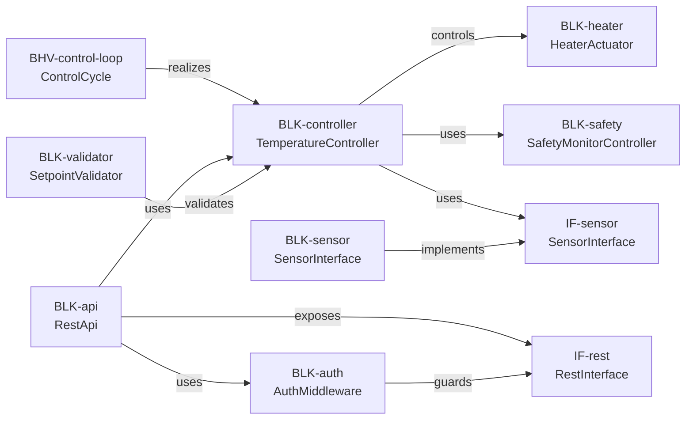

# SmartThermostat architecture

Version: 1.0.0

## Elements

| ID | Kind | Name | Satisfies | Allocated to |
| --- | --- | --- | --- | --- |
| BHV-control-loop | behavior | ControlCycle | REQ-001 | src/thermostat/controller.py |
| BLK-api | block | RestApi | REQ-009; REQ-010; REQ-013 | src/thermostat/api.py |
| BLK-auth | block | AuthMiddleware | REQ-011; REQ-012 | src/thermostat/auth.py |
| BLK-controller | block | TemperatureController | REQ-001; REQ-003; REQ-004; REQ-007 | src/thermostat/controller.py |
| BLK-heater | block | HeaterActuator | REQ-003; REQ-004 | src/thermostat/heater.py |
| BLK-safety | block | SafetyMonitorController | REQ-005; REQ-006 | src/thermostat/safety.py |
| BLK-sensor | block | SensorInterface | REQ-002 | src/thermostat/sensor.py |
| BLK-validator | block | SetpointValidator | REQ-008 | src/thermostat/validator.py |
| IF-rest | interface | RestInterface | REQ-009; REQ-010 | src/thermostat/api.py |
| IF-sensor | interface | SensorInterface | REQ-002 | src/thermostat/sensor.py |

## Relations

| From | To | Type |
| --- | --- | --- |
| BHV-control-loop | BLK-controller | realizes |
| BLK-api | BLK-auth | uses |
| BLK-api | BLK-controller | uses |
| BLK-api | IF-rest | exposes |
| BLK-auth | IF-rest | guards |
| BLK-controller | BLK-heater | controls |
| BLK-controller | BLK-safety | uses |
| BLK-controller | IF-sensor | uses |
| BLK-sensor | IF-sensor | implements |
| BLK-validator | BLK-controller | validates |

## Diagram

