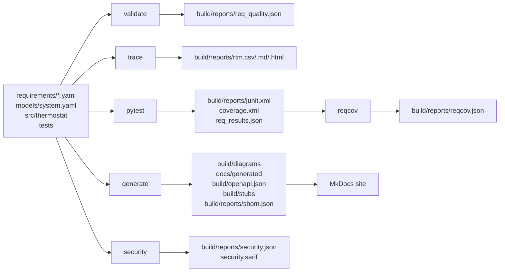

# Pipeline

The pipeline connects engineering artifacts — requirements, the system model,
tagged code, and requirement-based tests — and produces validation results,
traceability data, generated artifacts, and security evidence.



## Stages

### Validate

`mbse validate all` checks the requirement files against the requirement JSON
Schema, runs requirement quality rules, loads the system model, validates it
against the model schema, and checks model references. The same is available per
scope with `mbse validate schema`, `mbse validate reqs`, and
`mbse validate model`. Failures are printed as `path: rule severity: message`;
errors exit non-zero and the requirement quality report is written to
`build/reports/req_quality.json`.

### Trace

`mbse trace check` builds links from each requirement to model elements, code
tags, and tests, then reports traceability findings (rules `TRC-001` through
`TRC-006`) and prints traceability and verification coverage. `mbse trace rtm`
writes the requirement traceability matrix to `build/reports/rtm.csv`,
`build/reports/rtm.md`, and `build/reports/rtm.html`. The RTM includes the last
recorded test result from `build/reports/req_results.json`.

### Generate

`mbse generate` writes deterministic artifacts; it accepts `diagrams`, `docs`,
`openapi`, `test-stubs`, `sbom`, or `all`.

| Target | Output |
|---|---|
| `diagrams` | `build/diagrams/block-definition.puml`, `requirements.puml`, `block-definition.dot`, plus `block-definition.svg` when Graphviz `dot` is installed |
| `docs` | `docs/generated/requirements.md`, `architecture.md`, `rtm.md` rendered from Jinja2 templates |
| `openapi` | `build/openapi.json` from `thermostat.api.create_app`; fails if `GET /status` or `PUT /setpoint` is absent |
| `test-stubs` | `build/stubs/test_req_<nnn>.py` for requirements without a req-tagged test |
| `sbom` | `build/reports/sbom.json` in CycloneDX JSON, normalized and sorted |

Generated files contain no timestamps, so regenerating unchanged inputs produces
byte-identical output.

### Test and requirements coverage

`pytest` writes `build/reports/junit.xml`, `build/reports/coverage.xml`,
`build/htmlcov/`, and, through the repository pytest plugin,
`build/reports/req_results.json`. The latter maps each requirement ID to the
node IDs, outcomes (`passed`, `failed`, `skipped`), and durations of its
req-tagged tests.

`mbse reqcov` (or `make reqcov`) reads those results and computes coverage for
approved requirements: a requirement is covered when at least one of its
req-tagged tests passes. It writes `build/reports/reqcov.json` and prints
`requirements coverage: X% (covered/total)`. The default gate is 90%; override
it with `mbse reqcov --threshold FLOAT`. A custom results file can be supplied
with `mbse reqcov --results PATH`. Running below the threshold exits non-zero.

### Security

`mbse security` runs the available scanners and always writes
`build/reports/security.json` and `build/reports/security.sarif` (SARIF 2.1.0).
Each tool reports one of `passed`, `failed`, `unavailable`, or `error`.

| Tool | Scope |
|---|---|
| gitleaks | secret detection, with a Python fallback over working-tree files when gitleaks is unavailable |
| bandit | Python security issues in `src` and `pipeline/mbse` |
| semgrep | static analysis |
| pip-audit | known vulnerabilities in installed dependencies |
| trivy | filesystem/container scan |
| checkov | infrastructure-as-code under `infra/` |

`check_security_requirements` reports `SEC-001` for each approved requirement of
type `security` that has no req-tagged test. The gate fails on any gitleaks
finding, high-severity bandit or semgrep findings, any pip-audit vulnerability,
critical trivy findings, or high-severity checkov findings; `mbse security` exits
non-zero when the gate fails.

## Make targets

```bash
make validate   # mbse validate all
make trace      # mbse trace check
make test       # python -m pytest
make reqcov     # mbse reqcov
make security   # mbse security
make gen        # mbse generate all
make site       # make gen, then mkdocs build --strict
```

The site is built from this `docs/` tree; its navigation includes the generated
requirements, architecture, and RTM pages, so `make site` runs generation first.
