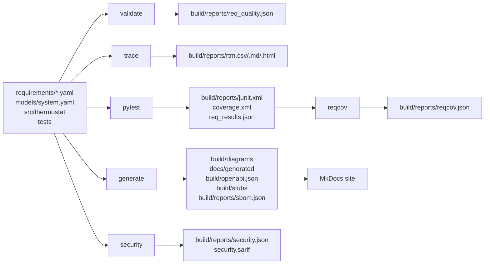

# Pipeline

The pipeline connects engineering artifacts — requirements, the system model,
tagged code, and requirement-based tests — and produces validation results,
traceability data, generated artifacts, and security evidence.



## Stages

### Validate

`mbse validate all` checks the requirement files against the requirement JSON
Schema, runs requirement quality rules, loads the system model, validates it
against the model schema, and checks model references. The same is available per
scope with `mbse validate schema`, `mbse validate reqs`, and
`mbse validate model`. Failures are printed as `path: rule severity: message`;
errors exit non-zero and the requirement quality report is written to
`build/reports/req_quality.json`.

### Trace

`mbse trace check` builds links from each requirement to model elements, code
tags, and tests, then reports traceability findings (rules `TRC-001` through
`TRC-006`) and prints traceability and verification coverage. `mbse trace rtm`
writes the requirement traceability matrix to `build/reports/rtm.csv`,
`build/reports/rtm.md`, and `build/reports/rtm.html`. The RTM includes the last
recorded test result from `build/reports/req_results.json`.

### Generate

`mbse generate` writes deterministic artifacts; it accepts `diagrams`, `docs`,
`openapi`, `test-stubs`, `sbom`, or `all`.

| Target | Output |
|---|---|
| `diagrams` | `build/diagrams/block-definition.puml`, `requirements.puml`, `block-definition.dot`, plus `block-definition.svg` when Graphviz `dot` is installed |
| `docs` | `docs/generated/requirements.md`, `architecture.md`, `rtm.md` rendered from Jinja2 templates |
| `openapi` | `build/openapi.json` from `thermostat.api.create_app`; fails if `GET /status` or `PUT /setpoint` is absent |
| `test-stubs` | `build/stubs/test_req_<nnn>.py` for requirements without a req-tagged test |
| `sbom` | `build/reports/sbom.json` in CycloneDX JSON, normalized and sorted |

Generated files contain no timestamps, so regenerating unchanged inputs produces
byte-identical output.

### Test and requirements coverage

`pytest` writes `build/reports/junit.xml`, `build/reports/coverage.xml`,
`build/htmlcov/`, and, through the repository pytest plugin,
`build/reports/req_results.json`. The latter maps each requirement ID to the
node IDs, outcomes (`passed`, `failed`, `skipped`), and durations of its
req-tagged tests.

`mbse reqcov` (or `make reqcov`) reads those results and computes coverage for
approved requirements: a requirement is covered when at least one of its
req-tagged tests passes. It writes `build/reports/reqcov.json` and prints
`requirements coverage: X% (covered/total)`. The default gate is 90%; override
it with `mbse reqcov --threshold FLOAT`. A custom results file can be supplied
with `mbse reqcov --results PATH`. Running below the threshold exits non-zero.

### Security

`mbse security` runs the available scanners and always writes
`build/reports/security.json` and `build/reports/security.sarif` (SARIF 2.1.0).
Each tool reports one of `passed`, `failed`, `unavailable`, or `error`.

| Tool | Scope |
|---|---|
| gitleaks | secret detection, with a Python fallback over working-tree files when gitleaks is unavailable |
| bandit | Python security issues in `src` and `pipeline/mbse` |
| semgrep | static analysis |
| pip-audit | known vulnerabilities in installed dependencies |
| trivy | filesystem/container scan |
| checkov | infrastructure-as-code under `infra/` |

`check_security_requirements` reports `SEC-001` for each approved requirement of
type `security` that has no req-tagged test. The gate fails on any gitleaks
finding, high-severity bandit or semgrep findings, any pip-audit vulnerability,
critical trivy findings, or high-severity checkov findings; `mbse security` exits
non-zero when the gate fails.

## Digital thread

The digital thread is a deterministic graph that connects every engineering and
delivery artifact. `mbse thread build` snapshots the repository into
`digital_thread/thread.json` and renders the graph; `mbse thread update` is the
incremental variant that also diffs against the previous snapshot, marks stale
downstream artifacts, and writes a history entry.

### Graph model

Node identifiers are stable: requirement `REQ-003`, model element
`BLK-controller`, code module path `src/thermostat/controller.py`, test
`tests/unit/test_controller.py::test_x` (class tests use
`file::Class::test`), test result `RESULT:<test id>`, report path
`build/reports/rtm.md`, a Git commit SHA (or `local` when Git is unavailable),
and release `release-<model version>`.

| Node type | Represents |
|---|---|
| `Requirement` | A requirement loaded from `requirements/*.yaml`, with title, type, status, priority, verification, and parent attributes |
| `ModelElement` | A block or element from `models/system.yaml`, with kind, name, satisfies, and allocated_to attributes |
| `CodeModule` | Every `src/**/*.py` file; its `implements` attribute lists the requirement IDs tagged in the file |
| `Test` | Every requirement-tagged test discovered by an AST walk over `tests/**/*.py` |
| `TestResult` | The recorded outcome and duration for a test, from `build/reports/req_results.json` or `junit.xml` |
| `Report` | Existing reports among `rtm.csv`, `rtm.md`, `rtm.html`, `req_quality.json`, `junit.xml`, `coverage.xml`, `reqcov.json`, `security.json`, `security.sarif`, `sbom.json`, and `thread_diff.md` |
| `Commit` | A Git commit that last changed an upstream artifact, with author, message, and short SHA |
| `Release` | `release-<model version>`, linked to the commits included in it |

Edges are directed from upstream to downstream:

| Edge type | Direction |
|---|---|
| `DERIVES_FROM` | Requirement → parent Requirement |
| `SATISFIES` | ModelElement → Requirement |
| `ALLOCATED_TO` | ModelElement → CodeModule |
| `IMPLEMENTS` | CodeModule → Requirement |
| `VERIFIES` | Test → Requirement |
| `EXERCISES` | Test → CodeModule that implements a verified requirement |
| `RESULT_OF` | TestResult → Test |
| `CHANGED_IN` | Requirement, ModelElement, CodeModule, or Test → Commit |
| `INCLUDED_IN` | Commit → Release |

Nodes are sorted by type and ID, edges by source, target, and type, and
attributes are serialized with sorted keys. Metadata (commit, author, branch,
workflow run, and tool versions) is the only place where timestamps appear, so
an unchanged repository produces byte-identical graph output.

### Commands

```bash
mbse thread build                              # full snapshot + visualizations
mbse thread update                             # snapshot, diff, staleness, history
mbse thread query --downstream REQ-003         # nodes reachable downstream
mbse thread query --upstream tests/unit/test_controller.py::test_x
mbse thread query --why-failed RESULT:tests/unit/test_controller.py::test_x
mbse thread query --history src/thermostat/controller.py
mbse thread query --downstream REQ-003 --json  # machine-readable output
```

`mbse thread query` requires exactly one of `--upstream`, `--downstream`,
`--why-failed`, or `--history`. Neighbour queries print one `type id` line per
node (test results also print their outcome) and exclude the start node.
`--why-failed` reports the test outcome together with its verified requirements
and exercised code modules. `--history` prints `commit subject` from
`git log --follow`. An unknown node or a missing option exits non-zero.

### Staleness

For each upstream → downstream edge, `mbse thread update` compares hashes with
the previous snapshot. When an upstream artifact changed but the downstream
`Test`, `CodeModule`, or `TestResult` did not, the downstream node is flagged
with `stale: true`; a stale test propagates the flag to its `TestResult`. Stale
node IDs are returned sorted and listed in the diff report, and clear once the
downstream artifact is updated. The first run, with no previous snapshot,
reports no stale nodes.

Snapshots live at `digital_thread/thread.json` (current) and
`digital_thread/history/<sha>.json` (one per commit, or `local` without Git).
Diffs are written to `build/reports/thread_diff.md` with Added, Removed, and
Modified nodes, Added and Removed edges, and Stale nodes; empty sections show
`-`.

### Visualizations

`mbse thread build` writes the GraphML model to
`build/reports/thread.graphml`, the deterministic DOT description to
`build/reports/thread.dot`, and, when Graphviz `dot` is installed,
`build/reports/thread.svg`. It also generates `docs/thread.html` (a
self-contained D3 v7 force-directed view with a type legend) and `docs/thread.md`
(the MkDocs page that embeds it); the navigation entry for this page is declared
in `mkdocs.yml` but the pages themselves are generated, not edited by hand.

### CI persistence

The thread workflow runs on pushes to `main` and on manual dispatch. It checks
out with full history, installs the package, runs `mbse thread update`, uploads
the `digital_thread/` directory as a workflow artifact, and publishes it to the
orphan `digital-thread` branch with a bot commit and a force push. The branch is
the durable, inspectable history channel; the artifact is the per-run copy.

## Make targets

```bash
make validate   # mbse validate all
make trace      # mbse trace check
make test       # python -m pytest
make reqcov     # mbse reqcov
make security   # mbse security
make gen        # mbse generate all
make site       # make gen, then mkdocs build --strict
```

The site is built from this `docs/` tree; its navigation includes the generated
requirements, architecture, RTM, and digital-thread pages. `make site` runs
generation for the first three; run `mbse thread build` beforehand to generate
`docs/thread.md` and `docs/thread.html` for the digital-thread entry.
